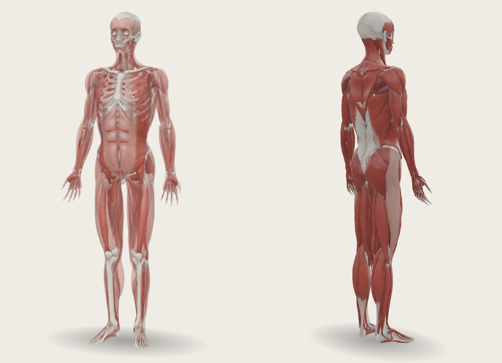

# Écorché

A complete human figure for the web and for 3D tools: the skeleton and the muscles of an adult male, **one named mesh per structure**, cleaned up so that layers sit in the right order and both sides match. Free to use, modify and ship under **CC BY-SA 4.0**.

**[Open the demo](https://charleeh.github.io/ecorche/)** · [Download `ecorche.glb`](model/ecorche.glb) · [Structure list](model/ecorche.structures.json)



The geometry comes from two open anatomy datasets, [BodyParts3D](https://dbarchive.biosciencedbc.jp/en/bodyparts3d/) and [Z-Anatomy](https://www.z-anatomy.com/). They were never modelled to fit together. Where they meet, muscles cross through each other. This project merges them, fixes those crossings with explicit anatomical rules, makes the left and right halves exact mirrors, and exports the result as standard glTF.

## What's inside

| | |
|---|---|
| Structures | 634 named meshes |
| Skeleton | 198 bones, 42 cartilages (costal, nasal, ear, intervertebral discs), 28 teeth, eyes |
| Deep muscles | 159 (psoas, iliacus, rotator cuff, multifidus, quadratus lumborum, deep calf…) |
| Superficial muscles | 203 (trapezius, deltoid, latissimus dorsi, erector spinae, glutes, quadriceps, hamstrings…), plus the posterior layer of the thoracolumbar fascia |
| Geometry | 486,005 vertices, 984,688 triangles |
| Units, axes | metres, Y up, the figure faces +Z, soles on y = 0 |

The repository has two files with the same content:

- **`model/ecorche.glb`** (13.7 MB): quantized geometry (`KHR_mesh_quantization`). It opens in Blender 3.0+, three.js, Babylon.js, `<model-viewer>` and most glTF viewers.
- **`model/ecorche.meshopt.glb`** (5.7 MB, 4.2 MB gzipped): the same file compressed with `EXT_meshopt_compression`, for the web. three.js and Babylon.js decode it; Blender does not.

### Scene layout

```
Ecorche                    root, scale 0.0001 (positions are int16 in units of 0.1 mm)
├── Skeleton
│   ├── Atlas
│   ├── Left femur
│   └── …
├── Deep muscles
│   ├── Left psoas major
│   └── …
└── Superficial muscles
    ├── Left gluteus maximus
    └── …
```

Each structure node carries `extras`, which three.js exposes as `object.userData`:

```json
{ "name": "Left gluteus maximus", "layer": "superficial muscles", "side": "left",
  "source": "BodyParts3D", "fma": "FMA22329" }
```

- `name`: the anatomical name. Some loaders rewrite spaces in node names, so read this field instead of the node name.
- `layer`: `skeleton`, `deep muscles` or `superficial muscles`.
- `side`: `left`, `right` or `midline`.
- `source`: the dataset the shape comes from.
- `fma`: the [Foundational Model of Anatomy](https://bioportal.bioontology.org/ontologies/FMA) concept ID, for structures from BodyParts3D.
- `group`: the muscle a piece belongs to, when one muscle is made of several meshes.
- `tissue`: `bone`, `cartilage`, `tooth` or `eye`, on skeleton nodes.

A few muscles have two meshes (for example the two heads of flexor digitorum superficialis). The second one is named with a `(2)` suffix.

### Materials and colour

There are two materials, `Bone` and `Muscle`, both white. The colour lives in the vertex colours (`COLOR_0`):

- bone is ivory, cartilage is pale blue-grey;
- muscle is red, and turns pale where it becomes tendon or aponeurosis (the ends of each muscle, the calcaneal tendon, the sheath of the external oblique, the lumbar part of the latissimus dorsi);
- a soft ambient occlusion is baked in.

To get flat colours instead, turn vertex colours off on the material.

## Use it

### three.js

```js
import * as THREE from 'three';
import { GLTFLoader } from 'three/addons/loaders/GLTFLoader.js';
import { MeshoptDecoder } from 'three/addons/libs/meshopt_decoder.module.js';

const loader = new GLTFLoader().setMeshoptDecoder(MeshoptDecoder);
loader.load('ecorche.meshopt.glb', (gltf) => {
  scene.add(gltf.scene);
  gltf.scene.traverse((o) => {
    if (o.isMesh && o.userData.layer === 'skeleton') o.visible = false; // muscles only
  });
});
```

[`index.html`](index.html) is the full demo in a single file: layer switch, x-ray slider for the outer muscles, search, click a structure to see its name.

### Blender

Use *File › Import › glTF 2.0* with `ecorche.glb` (not the meshopt one). The root node keeps its 0.0001 scale. Apply it (*Ctrl A › Scale*) if you want unscaled objects.

## How it was made

1. **Selection.** About 575 BodyParts3D meshes are kept: bones, cartilages, teeth, eyes and skeletal muscles. Z-Anatomy fills in what BodyParts3D lacks: latissimus dorsi, rectus abdominis, internal oblique, transversus abdominis, quadratus lumborum, multifidus, rotatores, the thoracolumbar fascia, and the muscles of the face and jaw.
2. **One frame.** Both datasets are converted to the same coordinate frame and simplified, with a tighter error budget on the skeleton than on the large muscle sheets.
3. **Layering.** Where the datasets disagree about what lies on top, the anatomy decides:
   - the trapezius lies over the latissimus dorsi;
   - the latissimus dorsi lies over the erector spinae and the serratus posterior inferior;
   - the external oblique's sheath lies over the rectus abdominis;
   - deep muscles stay under whatever covers them.

   The Z-Anatomy piece is the one that moves. Inside BodyParts3D, which is consistent with itself, only hairline overlaps of up to 4 mm are touched. Moves are spread smoothly over each surface, so nothing kinks.
4. **Symmetry.** Everything is clipped at the midline and the right half is rebuilt as the exact mirror of the left.
5. **Clean surfaces.** The external oblique and serratus anterior come as overlapping fibre bundles that flicker when rendered. Both are rebuilt as single smooth surfaces, within about 1 mm of the original shape.
6. **Orientation.** The Z-Anatomy meshes come wound inside out, which makes them look hollow in any renderer that culls back faces. Every closed surface is turned to face outward. The thoracolumbar fascia is a single open sheet, so it is turned to face away from the body.
7. **Export.** Normals, tendon tint and ambient occlusion are computed. The meshes are reordered for compression and written as glTF.

The whole pipeline is in [`tools/`](tools/README.md) and rebuilds the model from the original downloads:

```bash
cd tools
npm install
npm run fetch    # downloads the two datasets (about 165 MB) into tools/sources
npm run build    # writes model/ecorche.glb, model/ecorche.meshopt.glb, model/ecorche.structures.json
```

You need Node.js 20+ and Python 3. A full build takes about a minute and gives byte-identical files.

## Limits

- **Not for clinical use.** This is a teaching, visualisation and design asset, not a medical device. Positions are accurate to a few millimetres, not better.
- **One body.** It is a single adult male in the anatomical position. There is no female or child variant, no rig and no poses.
- **Only bones and muscles.** Organs, vessels, nerves, ligaments, joint capsules and skin are left out. The face muscles from Z-Anatomy are included but were not run through the layering pass.
- **Lighter than the source.** The meshes are simplified for real-time use. Fine relief such as tiny foramina or tooth cusps is softened.

## License and credits

- The **model** (`model/`, and any mesh derived from it) is licensed under **[CC BY-SA 4.0](LICENSES/CC-BY-SA-4.0.txt)**. Z-Anatomy's share-alike licence requires this, and it also satisfies the licences of BodyParts3D.
- The **code** (`index.html`, `tools/`) is licensed under the **[MIT License](LICENSES/MIT.txt)**.

If you use the model, credit it like this:

> Écorché (github.com/Charleeh/ecorche), CC BY-SA 4.0. Based on BodyParts3D, © The Database Center for Life Science, CC BY 4.0, and Z-Anatomy by Gauthier Kervyn, CC BY-SA 4.0.

If you change the meshes and share them, share them under CC BY-SA 4.0 too.

[ATTRIBUTION.md](ATTRIBUTION.md) gives the full credits, the original licence notices and the list of changes made to the source data.
